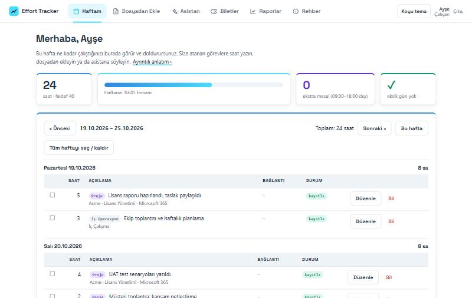
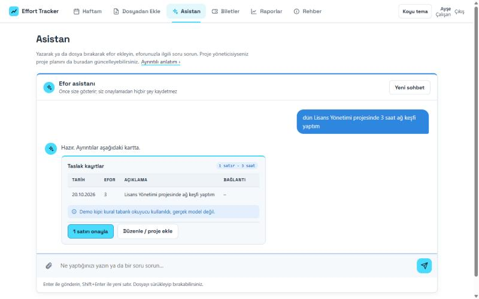
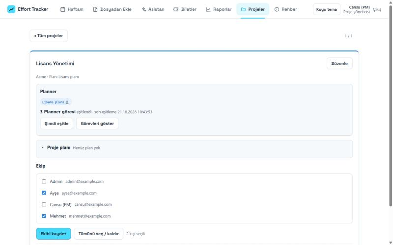
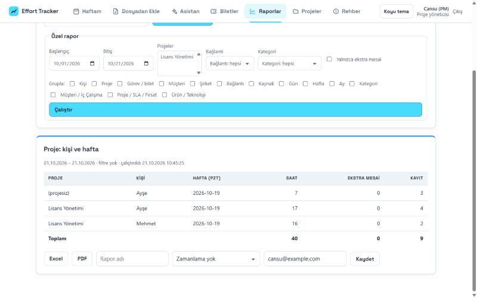
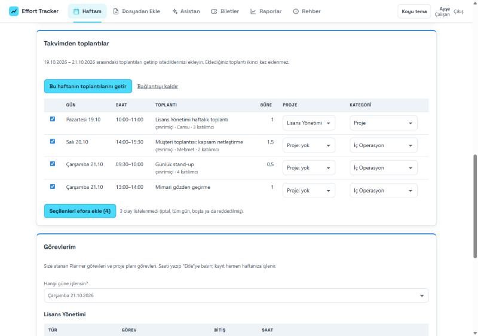
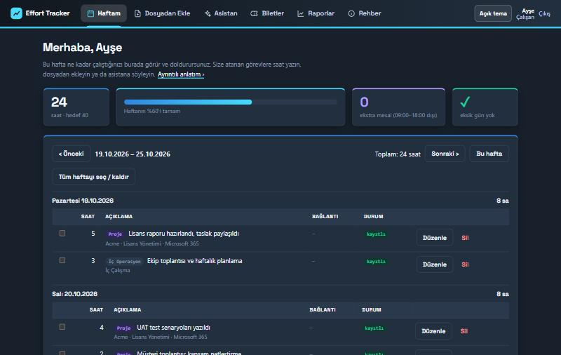

# Effort Tracker

**AI-assisted effort tracking for technical teams.** People report their work however they keep it – an Excel sheet, a text file, or one sentence in a chat – and the app turns it into confirmed, reportable effort rows tied to project plans and tickets. Nothing is saved until the person clicks *Onayla* (confirm).

> This is a runnable **preview** with fictional sample data. It needs no cloud account: `npm install && npm run dev:local`.
> The interface is in Turkish; code, comments and docs are in English.



## How it works

**AI reads, code decides.** The language model only *reads* – messy layouts and free text. Dates, hours, totals, duplicate checks, overtime, report numbers and every database write are plain, tested code, and the person confirms before anything is stored.

1. **Input.** Drop an Excel/CSV/text file, fill the standard daily form, type a sentence ("dün 3 saat ağ keşfi yaptım"), or enter the hours against a task.
2. **Read.** A deterministic pre-read recognises known layouts (a confirmed layout is remembered, so the model is skipped next time); the model is asked only for what code cannot read.
3. **Check.** Normalisation turns Turkish dates and hour expressions into numbers; checks flag duplicate files, steps that are not 15 minutes, missing customers, invalid categories and overtime (outside 09:00–18:00, on weekends and on Turkish public holidays; religious holidays are added by an admin).
4. **Review.** A draft table appears next to the source text; fix a row, pick the project or task, then confirm.
5. **Report.** Ready-made and custom reports, Excel with live `SUM` formulas, PDF, saved and scheduled by e-mail, a "missing days" report and Friday reminders.

| Assistant | Projects | Reports |
|---|---|---|
|  |  |  |

## Features

- **Chat assistant with fixed tools.** It can look up your effort, list tickets, draft rows and (for project managers) propose plan changes. It never writes by itself: every change is a *proposal card* with an explicit apply button. Numbers in its answers are checked against what the tools returned, and there is a prompt-injection test.
- **Edit any saved row.** Name, category, customer, project, product, date and times can all be changed after saving; choosing a project fills in the customer and the work name unless you typed your own. Calendar meetings can be renamed and re-assigned before they are added, and the project is guessed from shared words in the title.
- **Files in the chat.** Attach a file and choose which project it belongs to; every row is then linked to that project.
- **Projects.** Cards with team, plan and task status; create from a Planner plan (or one project per plan in bulk), edit name/customer/code, link effort to plan tasks. Merging several plans into one project asks for confirmation.
- **Planner sync.** Tasks of linked plans are cached and offered when entering effort ("Görevlerim"). Finished tasks and closed tickets are hidden.
- **Project plans from Excel.** Import a plan sheet (sections, owners, dates, status); a project manager can describe a change in words and get a list of edits to apply.
- **ITSM tickets.** A read-only connector lists open tickets per person and customer, with live detail on demand. Customers come from tickets plus a small "add customer" box.
- **Calendar meetings as effort.** Connect your own calendar once (delegated, read-only Microsoft Graph permission), fetch the week's meetings, tick the ones to add and pick project and category. Times come from the calendar; a meeting is never added twice; cancelled, all-day, free and declined events are left out. The refresh token is stored sealed (AES-256-GCM). Off unless `CALENDAR_ENABLED=1`; the demo uses a pretend calendar.
- **Roles.** Employee, project manager and admin see different slices: a PM sees the effort of people on their own projects, an admin sees everything.
- **Dark and light theme** and a responsive layout.





## Run it

Node 22+.

```bash
npm install
npm run dev:local     # http://localhost:3100 – in-memory PostgreSQL, sample week, rule-based stand-in for the model
npm test              # 188 tests
npm run typecheck
```

Demo sign-ins (no passwords): `ayse@example.com` (employee), `cansu@example.com` (project manager), `admin@example.com` (admin). Use the dev login on the sign-in page to switch between them.

The demo reader is a rule-based stand-in. In a real deployment the app uses Azure OpenAI, Microsoft Entra ID for sign-in, Microsoft Graph for Planner, PostgreSQL, Blob Storage and Key Vault (`infra/main.bicep`); `.env.example` lists the settings.

## Architecture

| Path | What |
|---|---|
| `src/core` | Pure logic, no I/O: Turkish dates and hours, Excel/text pre-read, layout fingerprints, normalise and checks, overtime, task linking |
| `src/server` | Express app: sign-in, upload pipeline, entries, chat tools, reports, Planner sync, ITSM connector, scheduler |
| `src/server/sql` | Migrations, applied at start-up (the app reports healthy only after they succeed) |
| `public` | Front end: plain ES modules, no build step; all text goes through `textContent`, never `innerHTML` |
| `infra` | Bicep template and app-registration manifest (not deployed from here) |
| `test` | Vitest; database tests run the real schema on an in-process PostgreSQL (PGlite); Graph, ITSM and the model are faked |

Design choices worth a look:

- **Everything that decides is deterministic and tested** – the model is a reader, never a calculator.
- **Pending actions.** Anything the assistant wants to change is stored as a pending action and applied only by an explicit request from the person.
- **Per-person visibility in one place** (`src/server/access.ts`), reused by lists, reports and the assistant's tools.
- **Safe rendering.** A small Markdown renderer builds DOM nodes (headings, lists, tables, links) so model output can never run as HTML.
- **Resilience.** The browser retries during a server restart and shows a "reconnecting" bar instead of an error.

## Tech stack

TypeScript (ESM) · Node 22 · Express 5 · PostgreSQL (`pg`, PGlite for tests and the demo) · zod · ExcelJS · PDFKit · Azure OpenAI · Microsoft Graph (Planner) · Microsoft Entra ID (OIDC) · Vitest · vanilla JavaScript front end.

## Known limits

- The integrations (sign-in provider, Graph, the language model, Blob Storage) are covered by fakes in the tests; this preview is not a hosted service.
- `.xls` is refused with a message to re-save as `.xlsx`.
- Leave days are dropped from uploads, not recorded.
- Weekly approval by a project manager is not built (the `approved` status exists in the schema).

See [ROADMAP.md](ROADMAP.md) for what is planned next.

## License

[MIT](LICENSE)
